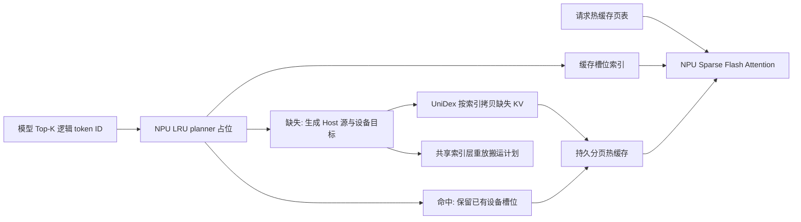

# 原生 HiSparse 的 Ascend NPU 适配方案与实现清单

## 1. 目标与当前状态

在 Ascend 后端接入标准 `--enable-hisparse`，复用原生 HiSparse 的请求生命周期、Host 备份、持久热缓存、LRU 状态和共享索引层预取。Attention 使用分页热缓存，避免旧 `sparsity_driven_kv_offload` 路径逐步汇聚所有 Top-K KV、再全部回填的额外拷贝。

- 日期：2026-11-12。
- SGLang 基线：`c7f3e2bdfd348d396f17f776f067f5765fa2bc52`。
- sgl-kernel-npu 基线：`233b9c856f8499101fe59a0f6c7871d7d049259c`。
- 两个仓库的开发分支均为 `feat/npu-hisparse`。
- 本次交付代码与接口设计，不编译、不运行 NPU 模型或性能测试。
- **仍有一个设备 kernel 占位：`plan_hisparse_swap()`。它明确抛出 `NotImplementedError`，补齐前不能启动这条推理路径。** 不能将此分支描述为已完成硬件验证的支持版本。

## 2. 首版范围

接通的代码范围：

- DeepSeek V3.2 / GLM DSA-family MLA，latent/RoPE 维度为 512/64。
- BF16 / FP16 KV，独立 latent、RoPE 存储；模型权重量化与 KV 量化是不同配置。
- 单机/单 PP stage 的普通 prefill（含 chunked prefill）与单 token decode；保留 TP 的上层协调流程。
- 标准 HiSparse 逻辑地址与物理热缓存地址分离；完整 index-K 按逻辑容量存放。
- NPU `PA_BSND` 稀疏 Attention，以及原生共享索引层的 anchor/skip 预取流程。
- graph 输入、输出和搬运计划使用固定形状；图捕获是否实际可用，需补齐 planner 后在真实 NPU 验证。

首版明确拒绝：V4/M3、FP8 KV、投机解码、PD、PP>1、CP/DCP、HiCache、外部 KV linker、KV sharding、压缩 indexer，以及会绕过普通 KV 写入口的 MLA preprocessing / NZ 布局。原生要求的 `--disable-radix-cache` 和不使用 mixed chunk 仍保留。

## 3. 数据路径



同一组共享索引层复用的是 Top-K 和槽位映射；每层仍有各自的 Host/Device KV。anchor 生成缺失计划后，原生 coordinator 在预取流上调用 NPU 的 copy-only 实现，skip 层通过事件等待搬运完成。

## 4. 地址空间：本次最关键的改动

必须区分三种索引：

1. **模型逻辑 token 位置**：Top-K 输出的原序列位置，用于查 `req_to_host_pool`。
2. **请求热缓存槽位**：该请求的缓存位置 `[0, C)`，另有槽位 `C` 存放长序列的最新 token。槽位顺序与时间顺序无关。
3. **设备物理 token 地址**：由页分配器分配，供 UniDex 写入 Device KV。

对于页大小 `P`，Attention 接口中的槽位 `s` 经页表访问：

```text
physical_token = block_table[request, s // P] * P + s % P
```

`block_table` 从原生 `req_to_device_buffer` 中每页的首 token 地址构造。该转换只处理整数索引，不搬 KV。planner 同时输出设备物理地址与请求缓存槽位。

- **decode**：用缓存槽位作为 `sparse_indices`，有效 KV 长度为 `min(seq_len, C+1)`。使用 `sparse_mode=0`，不能按缓存槽位重新施加原序列因果 mask；planner 必须先按原逻辑序列长度过滤无效 token。
- **prefill**：保留原始 token 位置，从逻辑页表单独生成物理 Attention 页表；绝不能修改 indexer 使用的原逻辑页表。
- **index-K 写入**：继续使用原始 `out_cache_loc`，覆盖 `physical_capacity × host_to_device_ratio` 的完整逻辑地址空间。
- **Attention KV 写入**：经 HiSparse 的 logical→physical 映射写入 split KV pool。

页大小必须为 16 的倍数且不超过 1024；缓存容量必须页对齐。不能把 GPU 上常见的 page_size=1 直接带入 NPU PA 接口。

## 5. 改动模块与工作量

这是运行时适配与一个新设备 planner 的组合。不能靠修改一个 Attention 参数完成。

| 模块 | 本次改动 | 状态 |
| --- | --- | --- |
| 配置校验 | 为 NPU 增加独立组合检查，避开 GPU DSA backend 白名单；限制 dtype、页大小、模型与不兼容配置 | 已写 |
| NPU KV pool | 新增 HiSparse NPU pool，Attention KV 映射到物理缓存，index-K 保持逻辑地址 | 已写 |
| allocator | 复用 HiSparse 双 allocator，注入 `NPUPagedTokenToKVPoolAllocator`；先于普通 Ascend 分配器选择 | 已写 |
| 容量 | attention pool 按设备容量，index-K 按 Host 扩展后的逻辑容量；复用已有 HiSparse indexer 内存计费 | 已写 |
| Host pool | split latent/RoPE 注册内存、分页槽位分配、staging/备份/换入适配 | 已写 |
| Host 生命周期 | 暴露已有 C 层 `shm_free_by_name`，避免释放所有进程共享内存误伤其他 pool | 已写，未编译 |
| coordinator | 复用原生请求加入、退出、缓存增长、LRU 状态和预取调度，覆盖 NPU planner 与 copy-only 操作 | 已写 |
| Attention | 通过热缓存槽位与请求页表直接调用 `npu_sparse_flash_attention(PA_BSND)` | 已写 |
| 模型执行入口 | 选择 NPU coordinator，复用现有 graph capture/replay 的 coordinator 绑定及真实请求数更新 | 已写，图执行未验证 |
| 缺失 KV 拷贝 | 复用现有 UniDex 分别搬 latent/RoPE；anchor 与 skip 使用同一计划接口 | 已写 |
| LRU planner | 查找命中、选择淘汰项、更新 LRU、生成槽位表与缺失搬运计划 | **设备实现占位** |
| 回归 | 增加 CPU 地址映射和契约测试，NPU 正确性/图执行/性能留待 kernel 补齐 | 见验证记录 |

本次实际涉及 19 个运行时/接口文件，另有 2 个测试文件和本篇文档。代码改动约千行，准确增删行数见文末统计。后续真正的 Ascend planner kernel 还涉及 tiling、设备实现、注册、精度和性能测试，其工作量不能由当前 Python 占位函数的行数估算。

## 6. 缺失 kernel 的接口与职责

位置：另一仓库的 `python/sgl_kernel_npu/sgl_kernel_npu/hisparse.py`，函数 `plan_hisparse_swap()`。

输入：

- `[B,K]` Top-K 逻辑位置、序列长度、请求池 ID、设备上的真实请求数量。
- `[请求容量,C+P]` 已缓存 token 表和对应物理地址。
- 请求到 Host token 槽位的映射、`int16` LRU 顺序。

原地写出：

- `[B,K]` Top-K 设备物理地址。
- `[B,K]` Top-K 对应的请求缓存槽位。
- 固定形状的 `miss_src`、`miss_dst` 和逐请求 `miss_count`。
- 更新后的 token 表和 LRU 顺序。

必须实现：

- 短序列的完整驻留快速路径，长序列最新 token 的预留槽位处理。
- 命中保持原位；仅淘汰非命中项；多个重复选择只插入/搬运一次，但保留注意力输入的重复语义。
- 与原生一致的替换顺序，保证共享索引层可按相同物理槽位重放计划。
- 将有效输出稳定压紧到前缀并以 `-1` 补齐；NPU SFA 遇到首个 `-1` 后不应再有有效项。
- 每次启动完整初始化输出，特别是 graph padding 行，防止旧搬运计划被重复执行。
- 固定形状、设备侧控制，不在 graph replay 中执行 CPU `.item()` 或按 miss 数量动态分配。

占位实现会立即报错；没有用空 kernel、全命中伪结果或未经验证的 CPU 回退冒充正确实现。

## 7. 代码入口

SGLang 新增目录：`python/sglang/srt/hardware_backend/npu/hisparse/`。

| 文件 | 职责 |
| --- | --- |
| `config.py` | 支持范围与容量几何校验 |
| `memory_pool.py` | NPU split KV pool 与 logical→physical 写入映射 |
| `host_pool.py` | 已注册 Host KV 存储与 UniDex 双向传输 |
| `layout.py` | 请求缓存槽位到分页布局的元数据转换 |
| `coordinator.py` | 原生 HiSparse coordinator 的 NPU 子类 |
| `attention.py` | prefill/decode 的分页 Sparse Attention 接入 |

主仓库修改入口：`arg_groups/hisparse_hook.py`、`mem_cache/kv_cache_configurator.py`、`mem_cache/allocator/hisparse.py`、`model_executor/model_runner.py`、`managers/hisparse_coordinator.py`、`hardware_backend/npu/attention/ascend_backend.py`。

算子仓库新增 `sgl_kernel_npu/hisparse.py`，并给共享内存控制接口补充按名称释放。原有 `_npu_paged_attention`、原有 compact offload 和 GPU HiSparse 默认选择不变。

## 8. 后续使用与验证

补齐 planner、构建包含本次修改的算子库后，启动参数的目标形式为：

```bash
python -m sglang.launch_server \
  --model-path <DSA_MODEL> \
  --device npu \
  --attention-backend ascend \
  --kv-cache-dtype bfloat16 \
  --page-size 128 \
  --disable-radix-cache \
  --enable-hisparse \
  --hisparse-config '{"device_buffer_size":4096,"host_to_device_ratio":2}'
```

上面不是已验证的启动命令；模型路径、TP、并发与容量需按实际设备设置。不要同时开启 `SGLANG_NPU_ENABLE_SPARSE_KV_OFFLOAD`。补 kernel 前命令会触发占位错误。

后续验证顺序：

1. planner 单测：全命中、全缺失、部分命中、短序列、长序列新 token、重复 token、非法索引、padding 请求、跨步 LRU。
2. 与无 offload 的分页 SFA 对比 Attention 输出；测试不连续物理页、chunked prefill、请求结束/重用/撤回。
3. 多层共享索引：证明搬运的是本层 KV，确认预取事件与下一组 plan 覆盖之间的依赖。
4. graph capture/replay：换 batch bucket、真实请求数变化、空行、缓存增长和最新 token 更新。
5. 分别测量 planner、Host→Device、Attention 与事件等待；确认命中 gather 和整 Top-K refill 消失，再评估总吞吐。

## 9. 本次验证记录与交付统计

已完成以下检查，未编译、未执行 NPU kernel 或模型推理：

- 18 个新增/修改 Python 文件通过 AST 语法检查。
- 修改范围通过 Ruff 格式检查、关键语法/名称检查和 import 排序；新增 Python 文件通过完整 F 规则检查。
- 两个仓库通过 `git diff --check`。
- 10 个 CPU 测试通过：SGLang 7 个，算子接口 3 个。覆盖非连续物理页、缓存槽位到 PA 地址的等价性、padding 请求、Top-K 形状、几何约束、decode 禁止对槽位施加因果 mask、prefill 保留 indexer 逻辑页表、miss 掩码和显式占位错误。
- Attention 调用和 UniDex 搬运在测试中使用 CPU mock；这些测试不代表真实 NPU 算子或整机服务验证。

代码统计（包含两个测试文件，不包含本文；新增文件按完整行数计）：

| 仓库 | 文件数 | 新文件 | 修改文件 | 新增行 | 删除行 |
| --- | ---: | ---: | ---: | ---: | ---: |
| `sglang` | 14 | 8 | 6 | +825 | -31 |
| `sgl-kernel-npu` | 7 | 2 | 5 | +256 | -0 |

含本文共 22 个文件。代码与测试合计新增 1081 行、删除 31 行。两个仓库均保留在 `feat/npu-hisparse` 的未提交工作区，未推送。

测试执行使用已有 Python 环境，设置 `TORCH_DEVICE_BACKEND_AUTOLOAD=0` 禁用设备后端自动加载，只运行 CPU 张量操作。Ruff 使用本机已有 wheel 中的可执行文件，没有安装或编译依赖。
