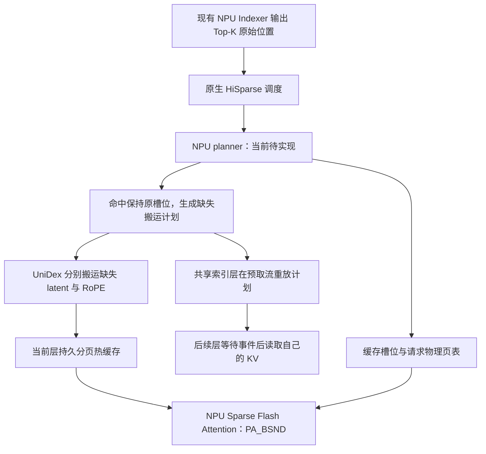

# HiSparse Ascend NPU 适配：改动点与功能说明

整理日期：2026-11-13。本文依据两个本地仓库的实际未提交改动整理；整体方案及此前验证记录见 [NPU_HISPARSE_ADAPTATION.md](NPU_HISPARSE_ADAPTATION.md)。

## 1. 改动目标与交付状态

目标是在 Ascend 后端接入标准 `--enable-hisparse`，复用原生 HiSparse 的请求生命周期、Host KV 备份、持久热缓存和共享索引层预取，让主 Attention 直接读取分页热缓存，仅为本步缺失的 KV 执行回搬。

| 仓库 | 分支 | 本次改动基线 | 文件范围，不含文档 |
| --- | --- | --- | --- |
| `sglang` | `feat/npu-hisparse` | `c7f3e2bdfd348d396f17f776f067f5765fa2bc52` | 13 个运行时文件、1 个测试文件 |
| `sgl-kernel-npu` | `feat/npu-hisparse` | `233b9c856f8499101fe59a0f6c7871d7d049259c` | 6 个运行时/接口文件、1 个测试文件 |

代码与测试合计 21 个文件，其中新增 10 个、修改 11 个。下文 `sglang` 内的链接相对于本仓库根目录；算子仓库链接假设 `sgl-kernel-npu` 位于同级目录。

**当前状态：运行时适配和搬运封装已写；`plan_hisparse_swap()` 的设备实现仍为占位，调用会抛出 `NotImplementedError`。该路径尚不能完成推理，也没有真实 NPU 正确性、图执行或性能验证结果。** 下文“已写”只表示代码存在。

## 2. SGLang 现有文件的改动

以下路径均以 `python/sglang/srt/` 为起点。

| 修改文件 | 具体改动 | 功能与作用 |
| --- | --- | --- |
| [arg_groups/hisparse_hook.py](python/sglang/srt/arg_groups/hisparse_hook.py) | 在 `validate_hisparse()` 中识别 NPU，调用新增的 `validate_npu_hisparse()` 后返回 | 将 NPU 参数交给专门的模型、KV dtype、后端与组合校验；保留前置的 radix cache、mixed chunk 等公共约束 |
| [mem_cache/kv_cache_configurator.py](python/sglang/srt/mem_cache/kv_cache_configurator.py) | NPU 开启 HiSparse 时选择 `NPUHiSparseTokenToKVPool`；将 `index_size` 设为 `max_total_num_tokens × host_to_device_ratio`；优先创建 HiSparse allocator 并注入 NPU 页分配器 | 让完整历史的 index-K 与较小的 Attention KV 设备缓存分别按各自容量分配；保证逻辑地址与物理地址的管理走 HiSparse 路径 |
| [mem_cache/allocator/hisparse.py](python/sglang/srt/mem_cache/allocator/hisparse.py) | 给 `HiSparseTokenToKVPoolAllocator.__init__()` 增加可选 `paged_allocator_cls` 参数，并优先使用传入的类 | 将原有逻辑/物理双 allocator 接到 `NPUPagedTokenToKVPoolAllocator`，复用现有映射、分配和回收流程 |
| [managers/hisparse_coordinator.py](python/sglang/srt/managers/hisparse_coordinator.py) | 抽出 `_create_mla_host_pool()`；在异步 staging/备份相关路径中为 NPU 张量调用 `record_stream()` | 允许 NPU 子类替换 Host 存储；让跨流使用的索引张量记录其使用流，避免内存过早复用 |
| [model_executor/model_runner.py](python/sglang/srt/model_executor/model_runner.py) | 在 `maybe_init_hisparse_coordinator()` 中根据 `self.device == "npu"` 选择 `NPUHiSparseCoordinator` | 在模型初始化阶段创建 NPU 适配对象，并交给现有执行流程使用 |
| [hardware_backend/npu/attention/ascend_backend.py](python/sglang/srt/hardware_backend/npu/attention/ascend_backend.py) | 检测 KV pool 是否为 `NPUHiSparseTokenToKVPool`，对 Top-K 做 padding 后转入 `forward_hisparse()` | 将 Ascend Attention 的执行入口接到新增的 HiSparse 分页读取路径 |

公共 coordinator 中的部分 `record_stream()` 改动也出现在投机备份代码内；本次 NPU 配置仍明确拒绝投机解码，不能据此认为投机解码已支持。

## 3. SGLang 新增 NPU 适配模块

目录：`python/sglang/srt/hardware_backend/npu/hisparse/`，共 7 个文件。

### 3.1 config.py：支持范围与容量校验

文件：[config.py](python/sglang/srt/hardware_backend/npu/hisparse/config.py)。

| 函数 | 实现内容 | 功能 |
| --- | --- | --- |
| `validate_geometry()` | 检查页大小、热缓存容量、Top-K 和 Host/Device 容量比例 | 在初始化前拒绝无法用于分页 Attention 或超出 LRU 槽位表示范围的配置 |
| `validate_npu_hisparse()` | 检查模型类别、MLA 维度、KV dtype、Attention 后端，以及不兼容的运行模式 | 明确首版适配边界，避免未经适配的组合进入运行时 |

关键约束：

- DSA MLA 模型，latent/RoPE 维度为 512/64；实际 KV 存储为 BF16 或 FP16。
- Attention 后端为 `ascend`；普通 prefill（含 chunked prefill）与单 token decode。
- 页大小 `P` 在 `[16, 1024]`，且是 16 的倍数。
- 热缓存容量 `C` 必须页对齐、不小于模型 Top-K，并且不超过 32767；最后一项来自 `int16` LRU 槽位表示。
- `host_to_device_ratio` 按正整数校验。
- 拒绝 V4/M3、FP8 KV、投机解码、PD、PP>1、CP/DCP、HiCache、外部 KV linker、KV sharding、压缩 indexer，以及旧 sparse KV offload、MLA preprocessing 和 NZ KV 布局等组合。

其中 `auto` KV dtype 可以通过配置阶段校验，pool 初始化时仍会检查最终 dtype 是否为 BF16/FP16。上述范围是当前适配代码的目标范围，真实模型支持情况仍需验证。

### 3.2 memory_pool.py：逻辑地址映射与设备 KV 存储

文件：[memory_pool.py](python/sglang/srt/hardware_backend/npu/hisparse/memory_pool.py)，新增 `NPUHiSparseTokenToKVPool`。

| 入口 | 实现内容 | 功能 |
| --- | --- | --- |
| `__init__()` | 继承 NPU MLA pool 与 HiSparse 映射 mixin；要求 latent/RoPE 分离存储，检查实际 dtype | 为 HiSparse 提供符合当前 NPU Attention 接口的设备存储布局 |
| `translate_loc_to_hisparse_device()` | 查询 `full_to_hisparse_device_index_mapping` | 将 allocator 的完整逻辑地址转换成设备物理 token 地址 |
| `set_kv_buffer()` / `set_mla_kv_buffer()` | 在 Attention KV 写入前转换地址；写入时将负地址送入 padding 区域；拒绝不支持的 layer override | 让模型仍使用原有写入入口，同时将 Attention KV 落到正确的设备位置 |
| `translate_loc_from_full_to_compressed()` | 对当前非压缩 DSA 适配直接返回输入 | 满足公共 HiSparse 的地址转换接口 |
| `transfer_values_on_device()` | 对各层 latent/RoPE 执行先读取、后写入的索引搬移 | 配合 allocator 调整物理缓存位置，兼容源/目标重叠的搬移 |

index-K 仍使用完整逻辑地址写入；Attention KV 使用逻辑到物理映射。这样 Indexer 能访问完整历史，而主 Attention 读取设备中的选中 KV。

### 3.3 host_pool.py：注册 Host 内存、备份与回搬

文件：[host_pool.py](python/sglang/srt/hardware_backend/npu/hisparse/host_pool.py)，新增 `NPUHiSparseHostPool`。

| 入口 | 实现内容 | 功能 |
| --- | --- | --- |
| `init_kv_buffer()` | 逐层为 latent 和 RoPE 创建共享内存张量，记录 NPU 可访问指针及唯一名称 | 保存 Host KV，并提供 UniDex 访问这些内存所需的地址 |
| `_transfer_layer()` | 统一处理 Host/Device 索引，分别搬 latent 与 RoPE | 适配 split KV 的双向搬运 |
| `backup_from_device_all_layer()` | 遍历各层执行 Device→Host 搬运 | 接入原生 HiSparse 的 staging 和 KV 备份流程 |
| `load_to_device_per_layer()` | 对指定层执行 Host→Device 搬运 | 接入按层换入接口 |
| `get_size_per_token()` / `get_mapping_lengths()` | 提供容量和注册内存长度信息 | 满足公共 Host pool 的记账与管理接口 |
| `destroy()` | 在上层等待相关流完成后，逐个按名称释放本 pool 拥有的映射；重复调用可直接返回 | 释放 Host 资源，保留其他 pool 的共享内存 |

初始化失败时也会清理已经创建的映射。L3 存储相关的数据页接口明确抛出 `NotImplementedError`；该 Host pool 用于 HiSparse 的内存备份与换入。

### 3.4 layout.py：生成分页 Attention 元数据

文件：[layout.py](python/sglang/srt/hardware_backend/npu/hisparse/layout.py)。

| 函数 | 实现内容 | 功能 |
| --- | --- | --- |
| `build_hot_cache_page_table()` | 从 `req_to_device_buffer` 取每页首 token 的物理地址，转换为物理页号；非法请求 ID 映射到 padding 页 | 构造 Attention 使用的请求热缓存页表，只处理元数据 |
| `normalize_topk()` | 将 `[B,K]`、`[B,1,K]`、`[B,1,1,K]` 统一为连续的 `[B,K] int32` | 对齐 planner 的单步 Top-K 输入格式，拒绝不支持的形状 |

### 3.5 coordinator.py：连接原生调度、NPU planner 与搬运

文件：[coordinator.py](python/sglang/srt/hardware_backend/npu/hisparse/coordinator.py)，新增 `NPUHiSparseCoordinator`。

它继承原生 coordinator，复用请求加入/退出、Host 槽位分配、缓存增长、备份调度、LRU 状态表和共享索引层的预取/等待流程。

| 入口 | 实现内容 | 功能 |
| --- | --- | --- |
| `__init__()` | 校验容量，分配 `top_k_cache_slots`；没有共享索引预取时也分配固定形状的 miss 计划缓冲区 | 为分页 Attention 与分离的 planner/copy 调用准备输出空间 |
| `_create_mla_host_pool()` | 返回 `NPUHiSparseHostPool` | 将公共生命周期接到 NPU Host 存储 |
| `_run_swap_in_kernel()` | 规范化 Top-K、检查宽度、调用 `plan_hisparse_swap()`，然后调用 copy-only 接口 | 生成地址与缺失计划，并将本层缺失 KV 搬入；当前会被 planner 占位异常阻断 |
| `_run_copy_only_kernel()` | 把计划和当前层的 Host/Device latent、RoPE 交给 `copy_cache_planned()` | 按同一计划搬运当前层自己的 KV |
| `prepare_attention()` | 复用 `swap_in_selected_pages()` 调度，再返回缓存槽位、热缓存页表和有效 KV 长度 | 将缓存管理结果转换为 NPU Sparse Attention 的输入 |

对于共享索引层，anchor 层生成计划，公共 coordinator 在预取流上为后续 skip 层重放计划；skip 层通过事件等待搬运完成。各层共享选择结果和槽位映射，各自保有 KV 数据。事件依赖和真实并行效果仍需 NPU 验证。

### 3.6 attention.py：直接读取分页热缓存

文件：[attention.py](python/sglang/srt/hardware_backend/npu/hisparse/attention.py)，新增 `forward_hisparse()`。

| 路径 | 实现内容 | 功能 |
| --- | --- | --- |
| KV 写入 | 需要保存 KV 时，调用新 pool 的映射写入接口 | 将本步生成的 Attention KV 写到设备物理位置 |
| Prefill | 保留原始 Top-K token 位置；从逻辑页表另行构造 Attention 物理页表；使用 `sparse_mode=3` | 支持普通/chunked prefill 的页式读取，同时保留 Indexer 需要的逻辑元数据 |
| Decode | 调用 `prepare_attention()`，将缓存槽位传入 `sparse_indices`；使用 `sparse_mode=0` | 直接读取持久热缓存，避免按缓存槽位错误地施加时间顺序的因果 mask |
| 算子调用 | 使用已有 `torch_npu.npu_sparse_flash_attention`，设置 `layout_query="TND"`、`layout_kv="PA_BSND"` | 执行选中 KV 的主 Attention 计算 |

Decode 的缓存槽位顺序不等于原序列顺序。逻辑 token 的有效范围必须先由 planner 过滤；这里的 `sparse_mode=0` 依赖这一契约。

本次实现的是 Attention 调用与地址适配；主 Attention 算子复用 NPU SFA。Indexer 的评分/Top-K 算子也沿用现有路径。

### 3.7 __init__.py：包入口

文件：[__init__.py](python/sglang/srt/hardware_backend/npu/hisparse/__init__.py)。新增包说明，组织上述 NPU HiSparse 模块。

## 4. sgl-kernel-npu 的改动

### 4.1 新增 hisparse.py：planner 契约与 UniDex 搬运封装

文件：[python/sgl_kernel_npu/sgl_kernel_npu/hisparse.py](../sgl-kernel-npu/python/sgl_kernel_npu/sgl_kernel_npu/hisparse.py)。

| 函数 | 当前实现 | 功能与状态 |
| --- | --- | --- |
| `plan_hisparse_swap()` | 定义输入、原地输出和行为约束，函数体抛出 `NotImplementedError` | **待实现**：命中检测、LRU 淘汰、状态更新、缓存槽位解析、缺失搬运计划生成 |
| `copy_kv_rows()` | 整理源/目标索引，构造有效掩码，调用已有 `unidex_copy_inplace()`；支持显式 Host 映射指针 | **封装已写**：按索引搬运 token 行，跳过负索引 |
| `copy_cache_planned()` | 根据 `num_real_reqs` 和 `miss_count` 屏蔽 padding 请求、计划尾部；分别调用 latent/RoPE 搬运 | **封装已写**：执行缺失 KV 计划，也供共享索引层重放使用 |

Planner 的主要输出约定：

| 输出 | 形状/类型 | 用途 |
| --- | --- | --- |
| `topk_device_locs` | `[B,K] int32` | Top-K 对应的设备物理 token 地址 |
| `topk_cache_slots` | `[B,K] int32` | Top-K 对应的请求内热缓存槽位 |
| `miss_src` | `[B,K] int64` | 缺失 KV 的 Host token 槽位 |
| `miss_dst` | `[B,K] int32` | 缺失 KV 的设备物理目标 |
| `miss_count` | `[B] int32` | 每个请求的有效搬运条目数 |
| 缓存 token 表与 `lru_slots` | 原地更新 | 保存跨 decode 步骤延续的缓存状态 |

待实现的设备 kernel 必须保护命中项、只淘汰非命中槽位，处理短序列完整驻留和长序列最新 token 专用槽位。重复选中的 token 只插入/搬运一次，但输出保留重复选择语义；有效输出稳定压紧到前缀，以 `-1` 补齐尾部。每次启动都需重置输出，包括 graph padding 行，并使用固定形状和设备侧控制。

### 4.2 按名称释放共享内存：5 个现有文件

| 修改文件 | 具体改动 | 功能 |
| --- | --- | --- |
| [csrc/sparsity_driven_kv_offload/shm_allocator/shm_allocator_op.cpp](../sgl-kernel-npu/csrc/sparsity_driven_kv_offload/shm_allocator/shm_allocator_op.cpp) | 新增 `shm_allocator_free_by_name()`，校验名称/设备 ID，调用已有底层 `shm_free_by_name()` 并检查返回值 | 将释放单个映射的能力暴露到扩展层 |
| [include/sgl_kenel_npu_ops.h](../sgl-kernel-npu/include/sgl_kenel_npu_ops.h) | 添加对应 C++ 函数声明 | 供 PyTorch 扩展注册引用 |
| [csrc/pytorch_extensions.cpp](../sgl-kernel-npu/csrc/pytorch_extensions.cpp) | 添加 schema 与实现注册 | 提供 `torch.ops.npu.shm_allocator_free_by_name` 调用入口 |
| [python/sgl_kernel_npu/sgl_kernel_npu/sparsity_driven_kv_offload/ops.py](../sgl-kernel-npu/python/sgl_kernel_npu/sgl_kernel_npu/sparsity_driven_kv_offload/ops.py) | 新增 Python `free_shm_by_name()` 包装，拒绝空名称 | 供 NPU Host pool 按名称清理自身资源 |
| [python/sgl_kernel_npu/sgl_kernel_npu/sparsity_driven_kv_offload/__init__.py](../sgl-kernel-npu/python/sgl_kernel_npu/sgl_kernel_npu/sparsity_driven_kv_offload/__init__.py) | 导入并导出 `free_shm_by_name` | 对 SGLang 提供公开 Python 接口 |

这一组变更复用底层已有的共享内存释放实现；新增的是 C++/PyTorch/Python 的调用链。扩展尚未编译验证。

## 5. 热缓存容量和地址含义

### 5.1 热缓存默认是多大

本次复用已有 [配置解析](python/sglang/srt/mem_cache/sparsity/factory.py) 的默认值：

```python
top_k = extra_config.pop("top_k", 2048)
device_buffer_size = extra_config.pop("device_buffer_size", 2 * top_k)
```

因此默认 `C = 4096`。对于每个请求、每层的长序列缓存：

| 口径 | 容量 |
| --- | --- |
| 参与 LRU 的历史 KV 热缓存 | `C` 个 token 槽位，默认 4096 |
| 加上最新 token 专用槽位 | `C + 1`，默认 4097 |
| 按页预留后的缓存容量 | `C + P`；当 `P=128` 时为 4224 |

这是请求缓存的配置容量；短序列可由原有流程按需增长，整个设备 KV pool 的大小还取决于服务内存配置与并发。

`2 * top_k` 中的 `top_k` 来自 HiSparse 配置；coordinator 的实际 Top-K 优先读取模型 `index_topk`。模型 Top-K 改变时，默认 `device_buffer_size` 不会自动重新按模型值翻倍。可用 `--hisparse-config '{"device_buffer_size":8192}'` 显式设置容量；该参数仍受页对齐和 Top-K 下限等约束。

### 5.2 必须区分的地址

| 地址或索引 | 含义 | 主要用途 |
| --- | --- | --- |
| Top-K 原始 token 位置 | 某请求序列内的位置 | Planner 判断命中及查询请求到 Host 槽位映射 |
| allocator 完整逻辑地址 | 如 `out_cache_loc` 中的地址，可跨请求分配 | index-K 写入，以及 Attention KV 的逻辑到物理转换 |
| 请求内热缓存槽位 | `[0,C)` 的历史槽位，长序列另有最新 token 槽位 `C` | Decode 的 `sparse_indices` |
| 设备物理 token 地址 | 设备 KV pool 内的实际存储位置 | KV 写入、回搬目标和物理页表寻址 |

缓存槽位 `s` 通过页表转换为设备地址：

```text
physical_token = block_table[request, s // P] * P + s % P
```

例如 `P=128`、请求第 0 个缓存页对应物理页 5，则缓存槽位 3 对应物理 token 地址 `5*128+3=643`。该槽位保存的原始序列 token 可以是 20，也可以是其他位置；LRU 更新后槽位内容可以变化。

## 6. 接入后的目标执行流程

下面展示 planner 补齐后的普通 decode 流程。当前执行会在图中标注的 planner 处抛出占位异常。



缓存命中时保留 KV 位置，缺失时只搬需要的 token；是否能在真实设备上获得预期收益，需要完成 planner 后测量。

## 7. 新增测试与验证状态

| 新增测试文件 | 测试数 | 覆盖功能 |
| --- | --- | --- |
| [test/registered/unit/npu/test_npu_hisparse.py](test/registered/unit/npu/test_npu_hisparse.py) | 7 | Decode 使用缓存槽位且不对槽位施加因果 mask；prefill 保留 Indexer 逻辑页表；非连续物理页与最新 token 槽位；非法请求 ID；分页地址与显式 gather 的 CPU Attention 参考结果等价；Top-K 形状；容量约束 |
| [tests/python/sgl_kernel_npu/test_hisparse_contract.py](../sgl-kernel-npu/tests/python/sgl_kernel_npu/test_hisparse_contract.py) | 3 | Planner 占位明确报错；`miss_count` 与真实请求数屏蔽旧计划/无效行并搬运对应层数据；零缺失时保持设备缓存内容 |

2026-11-12 的适配记录记载：10 个 CPU 测试通过，18 个新增/修改 Python 文件通过 AST 检查，修改范围通过相应 Ruff 格式/名称/import 检查，两个仓库通过 `git diff --check`。

**这些是此前记录，本次整理文档未重新运行代码测试。** 测试中的 NPU Attention 和 UniDex 使用 CPU mock；它们验证地址、参数与搬运契约，不能证明设备 kernel 或完整服务可运行。

## 8. 尚待完成的工作

| 工作 | 需要验证的功能 |
| --- | --- |
| 实现并注册 Ascend LRU planner | 命中/缺失、淘汰顺序、重复 token、最新 token、跨步状态更新及输出初始化 |
| 编译算子扩展 | Planner 注册调用链和按名称释放共享内存的接口可用 |
| NPU Attention 对齐测试 | 与无 offload 路径对比输出；覆盖不连续物理页、chunked prefill、请求结束/复用/撤回 |
| 多层共享索引与图执行 | 各层读取自身 KV，预取事件依赖正确；graph capture/replay、batch bucket 切换和 padding 请求正确 |
| 性能测量 | 分别测量 planner、Host→Device 搬运、Attention 和等待，再评估总吞吐与延迟 |
